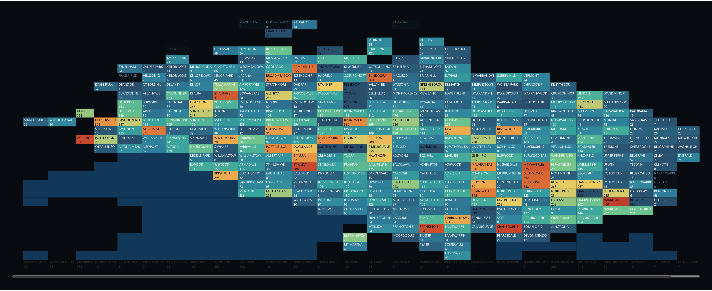
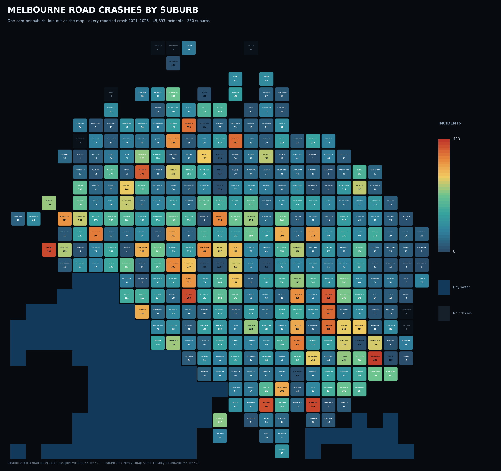

# Melbourne road-crash card map

A Power BI **matrix-based card map** of Melbourne: one card per suburb, showing the
number of reported road crashes from 2021–2025. It is shaped like Melbourne but uses
**no map visual** — just a matrix (Power BI `pivotTable`) with fixed grid coordinates.

*Screenshot exported from the published Fabric report. Each coloured tile is a matrix cell.*

## The idea

Power BI's map visuals are great, but sometimes you want the visual grammar of a map
with the control of a table: consistent cards, exact labels, no geography licence, no
Azure Maps dependency. This build turns 380 Melbourne suburbs into a 27×27 grid of
cards:

- **Rows** = north–south grid position (`ROW`, 1 at the top)
- **Columns** = east–west grid position (`COL`, 1 at the left)
- **Values** = a `Card` measure returning `SUBURB + newline + incident count`
- **Cell background / font colour** = driven by colour columns through Power BI
  field-value conditional formatting
- **Port Phillip Bay** = grid cells marked as water, drawn as a flat blue area

The result reads as Melbourne, while remaining a plain matrix visual.

## Data and method

- **Source:** [Victoria road crash data](https://discover.data.vic.gov.au/dataset/victoria-road-crash-data),
  Transport Victoria, CC BY 4.0.
- **Period:** 2021–2025 (five complete calendar years).
- **Incidents:** 45,893 across 380 suburbs. 461 fatalities, 15,423 serious injuries.
- **Suburb boundaries:** Vicmap Admin Locality Boundaries, CC BY 4.0.
- **Method:** each crash was point-in-polygon joined to its suburb, suburb centroids
  were projected to a tile cartogram, collision-resolved into a 27×27 grid, and bay
  cells were detected from locality coverage.

Top suburbs: Melbourne 1,296 · Dandenong 610 · Epping 598 · Preston 578 ·
Thomastown 514 · Berwick 460.

## Published reports

| Location | Workspace | Report ID |
|---|---|---|
| My workspace (requested) | `2c8690af-91fa-4905-a7ef-cb0f26e46712` | `634edd66-9cf4-410a-b65a-bea5c5ad945d` |
| Fabric Learning Workspace (render-verified) | `6881ccf8-e614-4ab8-b02d-c4820eded362` | `82d14a19-a8b4-434f-98c3-6fed0e9ee6d5` |

Open in Fabric:

- https://app.fabric.microsoft.com/groups/2c8690af-91fa-4905-a7ef-cb0f26e46712/reports/634edd66-9cf4-410a-b65a-bea5c5ad945d
- https://app.fabric.microsoft.com/groups/6881ccf8-e614-4ab8-b02d-c4820eded362/reports/82d14a19-a8b4-434f-98c3-6fed0e9ee6d5

The semantic model (`238e1dd5-e61d-43ab-84e0-3b4b6591b98b`) is in Fabric Learning
Workspace because personal workspaces block the Power BI APIs needed to host and
refresh models. Both reports bind to the same model.

## Files

| File | Purpose |
|---|---|
| `report_live_render.png` | Screenshot of the published Fabric report |
| `cardmap_final.png` | Styled design render of the same data |
| `cardmap_v2.csv` | Exact 485-row grid embedded in the semantic model |
| `cardmap_grid.csv` | Earlier full grid with labels and colours |
| `build_cardmap.py` | Downloads/processes the data and spatially joins suburbs |
| `layout.py` | Tile cartogram layout and bay detection |
| `preview.py` | Renders the design preview |
| `ReportProject/` | PBIP/PBIR source for the published report |
| `linkedin-post.md` | Draft LinkedIn post |

## Rebuilding

The semantic model embeds its data as inline M (Import mode), so the report needs no
gateway, credential, or refresh source. That was a deliberate choice because the trial
capacity's Spark load endpoint was rate-limited.

For the visual: use `pivotTable`, not legacy `matrix`. Conditional formatting must go
into the values `backColor` / `fontColor` slots — the `*Primary` slots are banded-row
styling and silently ignore field-value colours.

## Attribution

Crash data © Transport Victoria, CC BY 4.0. Locality boundaries © Vicmap, CC BY 4.0.
Built with Microsoft Fabric, Power BI and the Fabric skills in OpenCode.
